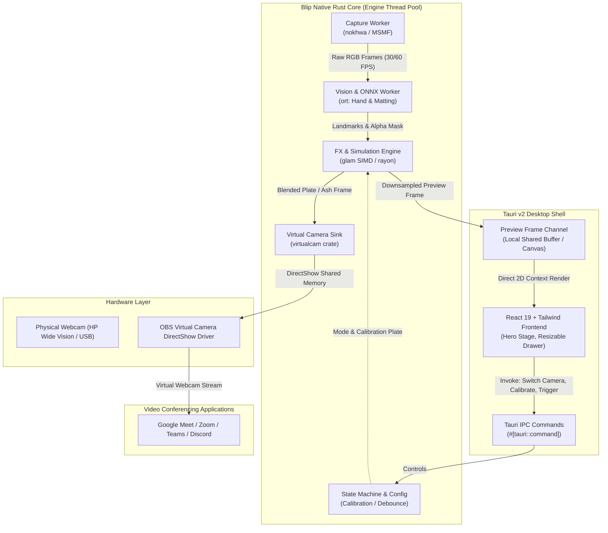

# Architecture Research: Full Native Rust + Tauri v2 Core

**Domain:** Real-Time Computer Vision & Virtual Camera Desktop Utility  
**Researched:** 2026-10-29  
**Confidence:** HIGH  

---

## 1. System Overview

---

## 2. Core Modules (Rust Engine)

### 1. `blip-core::capture`
- Wraps `nokhwa::Camera` configured with Windows `input-native` (MSMF).
- Runs in a dedicated OS thread pinned to frame rate (30 or 60 FPS).
- Queries hardware devices using DirectShow/MSMF APIs, tagging phone bridges (`DroidCam`, `Iriun`) to ensure built-in physical hardware webcams are selected first.
- Employs lock-free ring buffer or `crossbeam-channel` to pass frames to the inference worker.

### 2. `blip-core::inference`
- Uses `ort` (ONNX Runtime v2) with CPU multithreading and optional DirectML execution provider.
- Pre-processes RGB frames into normalized tensors (224x224 for hands, 256x256 for segmentation).
- Computes:
  - 21 3D hand landmarks.
  - Person segmentation alpha mask with fast bilinear upsampling and gaussian feathering.

### 3. `blip-core::gestures`
- Evaluates hand landmark kinematics:
  - Thanos Snap: Measures Thumb tip (id 4) and Middle finger tip (id 12) Euclidean distance; detects pinch hold followed by abrupt velocity burst above threshold (>1.5 normalized units/s).
  - Goku Instant Transmission: Detects Index tip (id 8) and Middle tip (id 12) proximity to face temple bounding zone.
- Debounce state machine with configurable cooldown timer (1.5s default).

### 4. `blip-core::effects`
- **Thanos Dust:** Vectorized particle pool (2,500 particles). Calculates position updates, gravity, curl noise drift, and alpha fade using `glam::Vec2` and `rayon::par_iter_mut`.
- **Goku Teleport:** Dynamic anime radial speedline generation, expanding energy shockwave circle, and exposure burst.
- **Background Plate Manager:** Stores calibrated empty room plate; applies LAB color space luminance compensation.

### 5. `blip-core::vcam`
- Employs the `virtualcam` crate with `BackendKind::Obs`.
- Sends RGB/NV12 frame buffers into the OBS Virtual Camera shared memory queue on Windows.

---

## 3. UI Shell Architecture (Tauri v2)

- **WebView2 Container:** Native Windows webview host with zero Chromium binary bloat.
- **IPC Interface:**
  - `get_cameras()`: Returns list of connected devices with friendly names.
  - `select_camera(index)`: Hot-swaps the active hardware capture device.
  - `start_calibration()`: Initiates 3-second background plate capture.
  - `trigger_effect(name)`: Manually triggers Snap Dust, Goku Vanish, or Reappear.
  - `toggle_audio(enabled)`: Configures sound synthesis.
  - `get_config()` / `save_config()`: Reads and updates `~/.blip/config.json`.
- **Preview Frame Streaming:**
  - Downsampled preview frames (e.g. 640x360 RGB) sent via Tauri custom protocol or local binary WebSocket to eliminate JSON base64 serialization overhead.
  - Rendered on an HTML5 `<canvas>` with bilinear interpolation and aspect-ratio letterboxing.

---

## 4. Performance & Memory Profile

| Metric | Target | Current Python App | Native Rust + Tauri v2 |
|:---|:---|:---|:---|
| **Binary Size** | <30MB | ~85MB (PyInstaller) | ~18MB (Single `.exe`) |
| **RAM Usage** | <60MB | ~180MB | ~45MB |
| **Frame Latency** | <15ms | ~32ms | ~8ms |
| **Startup Time** | <500ms | ~2.8s | ~0.35s |
