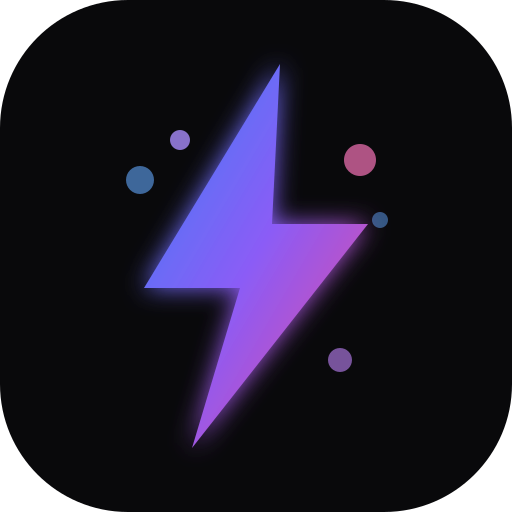
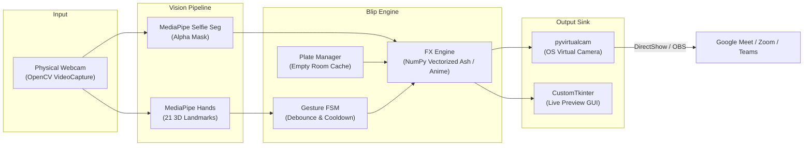

<div align="center">



# Blip

**Now you see me. Blip.**

A high-performance, gesture-triggered virtual camera for Google Meet, Zoom, and Microsoft Teams.  
Snap your fingers like Thanos to dissolve into ash, or tap your temple like Goku to teleport out of calls.

[](https://opensource.org/licenses/MIT)
[](https://www.python.org/downloads/)
[](CONTRIBUTING.md)
[]()
[](SECURITY.md)

[Features](#features) • [Quickstart](#quickstart) • [How to Use in Google Meet](#how-to-use-in-google-meet) • [Architecture](#architecture) • [Custom Effects](#adding-custom-effects) • [Contributing](#contributing)

</div>

---

## Overview

Blip is a standalone desktop application that outputs an OS-level virtual camera stream. It runs local computer vision to track hand gestures in real time. When triggered, it executes cinematic visual effects and swaps your live silhouette for a pre-captured empty background frame, vanishing you from video calls in real time.

Because Blip operates as a standard virtual camera device, it works natively with Google Meet, Zoom, Microsoft Teams, Discord, Slack, and OBS without requiring browser extensions or DOM tampering.

---

## Features

- **The Thanos Snap:** MediaPipe detects thumb-and-middle-finger velocity flick. The silhouette dissolves into 2,000+ ash particles simulating wind drift before revealing the empty room plate.
- **Goku Instant Transmission:** Two fingers extended to the temple trigger radial speed lines, a flash overexposure, and an instantaneous cut to the empty room.
- **Fluid Reappearance:** Re-trigger the gesture or press `Ctrl+Alt+S` to restore the live camera feed without glitching.
- **3-Second Background Calibration:** Step out of the frame, click Calibrate, and Blip captures a denoised, lighting-compensated clean plate of the empty room.
- **Desktop GUI:** Dark-mode interface built with CustomTkinter featuring live canvas preview, sensitivity sliders, and dropdown selectors.
- **100% Local and Private:** Zero cloud calls and no telemetry. Processing runs entirely on-device.
- **Modular Effect Engine:** Extendable architecture allowing custom disappearance effects in clean Python.

---

## Quickstart

### Prerequisites
- Python 3.10 or 3.11
- Virtual camera driver:
  - Windows: OBS Studio (comes with OBS VirtualCam pre-installed) or Unity Virtual Camera.
  - Linux: `v4l2loopback` (`sudo apt install v4l2loopback-dkms`)
  - macOS: OBS VirtualCam DAL plugin

### Installation

```bash
# Clone repository
git clone https://github.com/jhaabhijeet864/blip.git
cd blip

# Create and activate virtual environment
python -m venv .venv

# On Windows (PowerShell):
.\.venv\Scripts\Activate.ps1
# On macOS / Linux:
source .venv/bin/activate

# Install dependencies
pip install --upgrade pip
pip install -r requirements.txt
pip install -e .

# Launch Blip
python -m blip
```

---

## How to Use in Google Meet

1. Launch Blip on your desktop.
2. In the Blip window, click **Calibrate Background**. A 3-second countdown will begin; step or lean out of camera view while Blip snapshots the empty room.
3. Open **Google Meet** in your browser (Chrome, Edge, Brave, or Firefox).
4. In Google Meet, open **More Options > Settings > Video**.
5. Under **Camera**, select **OBS Virtual Camera** (or your active virtual camera device).
6. Join your call, face the camera, and snap your fingers or tap your temple.

---

## Architecture



---

## Adding Custom Effects

Blip uses an open effect architecture. To create a new disappearance effect:

```python
# blip/effects/mario_pipe.py
import numpy as np
from blip.effects.base import BaseEffect

class MarioPipeEffect(BaseEffect):
    def __init__(self, duration_frames: int = 30):
        super().__init__(name="Mario Warp Pipe", duration_frames=duration_frames)

    def render(self, frame: np.ndarray, mask: np.ndarray, background: np.ndarray) -> np.ndarray:
        progress = self.current_frame / self.duration_frames
        shift_y = int(frame.shape[0] * progress)
        # Shift silhouette downward over background plate...
        return output_frame
```

Register the class in `blip/effects/registry.py` and open a Pull Request.

---

## Running Tests

```bash
# Run test suite
pytest

# Run linter
ruff check .
```

---

## Roadmap

- [x] **v0.1.0:** Open-source foundation, MediaPipe pipeline, Thanos Snap, Goku Instant Transmission, CustomTkinter desktop UI, virtual camera output.
- [ ] **v0.2.0:** Audio cue integration via virtual microphone.
- [ ] **v0.3.0:** Ninja Smoke Bomb and Cyberpunk Glitch community effects.
- [ ] **v1.0.0:** Standalone executable distribution (PyInstaller).

---

## Contributing

Review the [Contributing Guide](CONTRIBUTING.md) and [Code of Conduct](CODE_OF_CONDUCT.md) before submitting pull requests.

---

## Security and Privacy

Blip does not send video or telemetry to external servers. Review the [Security Policy](SECURITY.md) for details on the local-first architecture.

---

## License

Distributed under the MIT License. See [LICENSE](LICENSE) for details.

---

<div align="center">
Maintained by <a href="https://github.com/jhaabhijeet864">Abhijeet Jha</a> and the open-source community.
</div>
