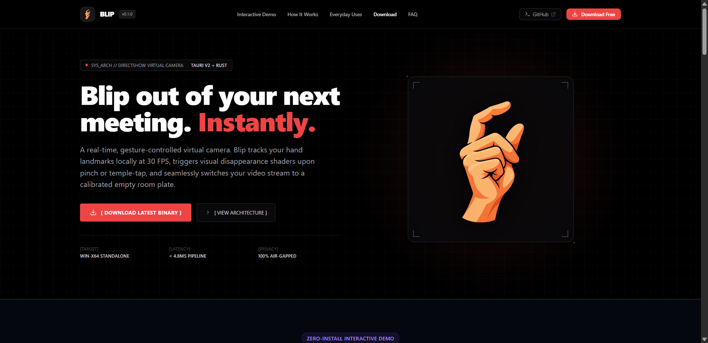
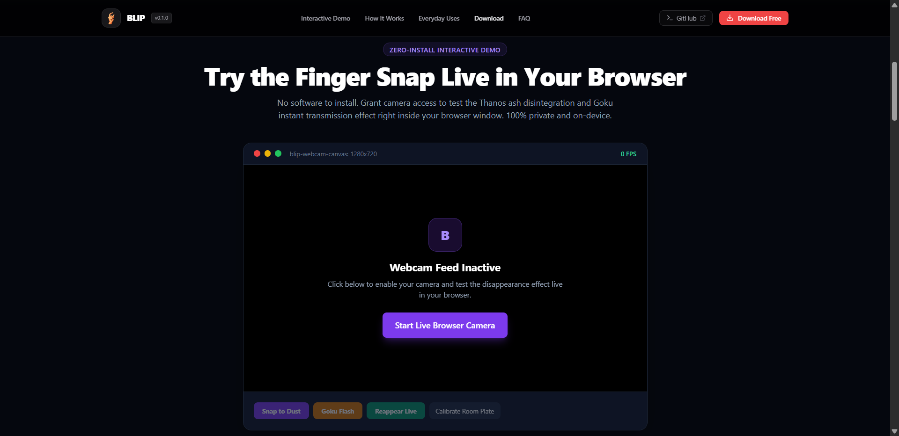
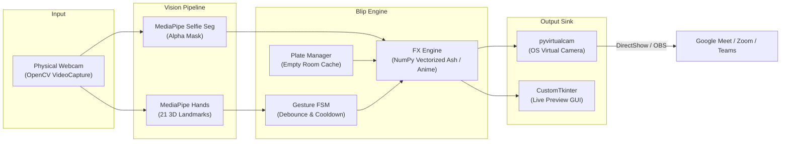

<div align="center">


# Blip

**Now you see me. Blip.**

A high-performance, gesture-triggered virtual camera for Google Meet, Zoom, and Microsoft Teams.  
Snap your fingers like Thanos to dissolve into ash, or tap your temple like Goku to teleport out of calls.

[](https://opensource.org/licenses/MIT)
[](https://jhaabhijeet864.github.io/blip)
[](https://www.python.org/downloads/)
[](CONTRIBUTING.md)
[]()
[](SECURITY.md)

<br/>

[](https://jhaabhijeet864.github.io/blip)

[Features](#features) • [Interactive Showcase](#interactive-web-simulator) • [Quickstart](#quickstart) • [How to Use in Google Meet](#how-to-use-in-google-meet) • [Architecture](#architecture) • [Custom Effects](#adding-custom-effects) • [Contributing](#contributing)

</div>

---

## Overview

Blip is a standalone desktop application that outputs an OS-level virtual camera stream. It runs local computer vision to track hand gestures in real time. When triggered, it executes cinematic visual effects and swaps your live silhouette for a pre-captured empty background frame, vanishing you from video calls in real time.

Because Blip operates as a standard virtual camera device, it works natively with Google Meet, Zoom, Microsoft Teams, Discord, Slack, and OBS without requiring browser extensions or DOM tampering.

---

## Interactive Web Simulator

Experience Blip directly in your browser without installing native drivers. The interactive web simulator runs real-time MediaPipe vision tracking and procedural canvas shaders:

<div align="center">



*Interactive Zero-Install Meeting Simulator running real-time silhouette tracking and Thanos disintegration in the browser.*

</div>

---

## Features

- **The Thanos Snap:** Native kinematics tracks thumb-and-middle-finger pinch and explosive flick velocity. The subject silhouette disintegrates into 3,500+ ash particles simulating upward buoyant lift and trigonometric curl turbulence before revealing the clean empty room plate.
- **Goku Instant Transmission:** Dual-finger raise to the temple zone triggers high-contrast anime radial speedlines, whiteout exposure flash bloom, expanding shockwave ring, and instant vanish.
- **Fluid Reappearance:** Re-trigger the gesture or press `Ctrl+Alt+S` to restore the live camera feed with smooth cubic ease-out alpha dissolve or reverse flash.
- **3-Second Background Calibration:** Step out of the frame, click Calibrate, and Blip captures a denoised, lighting-compensated clean plate of the empty room using real-time LAB color space luminance drift compensation.
- **Modern Tauri v2 Desktop GUI:** Sleek dark-mode interface built with React 19, Vite, and Tailwind CSS running in a lightweight native Windows WebView2 shell (<50MB RAM footprint).
- **Mouse-Draggable Sidebar Resizer:** Interactive splitter between hero video viewfinder and control settings with smooth mouse drag and persistent `localStorage` width storage.
- **Hardware Webcam Auto-Prioritization:** Intelligently discovers all connected devices, prioritizing genuine hardware webcams (e.g. HP Wide Vision HD Camera) and demoting phone bridges (DroidCam, Iriun) to prevent black-screen confusion.
- **100% Local and Private:** Zero cloud calls and no telemetry. Processing runs entirely on-device with embedded ONNX models.

---

## Quickstart

### Native Rust + Tauri Desktop (Recommended)

Requires Rust 1.80+ and Node.js 20+:

```bash
# Clone repository
git clone https://github.com/jhaabhijeet864/blip.git
cd blip

# Install frontend dependencies
npm --prefix ui install

# Run desktop app in development mode
npm --prefix ui run build
cargo run -p blip-desktop

# Or package standalone distribution executable:
powershell scripts/build_release.ps1
```

### Python Prototype

```bash
# Setup virtual environment
python -m venv .venv
.\.venv\Scripts\Activate.ps1   # Windows
source .venv/bin/activate       # macOS / Linux

# Install dependencies
pip install -r requirements.txt
pip install -e .

# Launch Python app
python -m blip
```

---

## How to Use in Google Meet

1. Launch Blip on your desktop.
2. In the Blip window, click **Calibrate Background**. A 3-second countdown will begin; step or lean out of camera view while Blip snapshots the empty room.
3. Open **Google Meet** in your browser (Chrome, Edge, Brave, or Firefox).
4. In Google Meet, open **More Options > Settings > Video**.
5. Under **Camera**, select **OBS Virtual Camera** (or your active virtual camera device).
6. Join your call, face the camera, and snap your fingers or tap your temple.

---

## Architecture



---

## Adding Custom Effects

Blip uses an open effect architecture. To create a new disappearance effect:

```python
# blip/effects/mario_pipe.py
import numpy as np
from blip.effects.base import BaseEffect


class MarioPipeEffect(BaseEffect):
    def __init__(self, duration_frames: int = 30):
        super().__init__(name="Mario Warp Pipe", duration_frames=duration_frames)

    def render(self, frame: np.ndarray, mask: np.ndarray, background: np.ndarray) -> np.ndarray:
        progress = self.current_frame / self.duration_frames
        shift_y = int(frame.shape[0] * progress)
        # Shift silhouette downward over background plate...
        return output_frame
```

Register the class in `blip/effects/registry.py` and open a Pull Request.

For full specifications and sample particle systems, read the [Custom Effect Authoring Guide](docs/EFFECT_AUTHORING.md) and [Gesture Math Guide](docs/GESTURE_GUIDE.md).

---

## Running Tests & Quality Gates

Blip includes comprehensive test suites across both native Rust and Python:

```bash
# Run native Rust workspace tests (27 unit & integration tests)
cargo test --workspace

# Run Python test suite with line-by-line coverage (77 tests)
pytest --cov=blip --cov=scripts --cov-report=term-missing

# Run code linters and formatting checks
cargo fmt --all -- --check
cargo check --workspace
ruff check .
```

---

## Release Automation

Blip provides assistive tooling for zero-error semantic releases:

```bash
# Preview next patch release (dry run)
python scripts/release.py --dry-run --bump patch

# Automatically run tests, bump version in pyproject.toml & blip/__init__.py, and create git tag
python scripts/release.py --bump patch

# Push release tag to trigger GitHub Actions release workflow
git push origin main --tags
```

Releases can also be triggered manually via GitHub Actions (`workflow_dispatch`) with optional draft and pre-release flags.

---

## Roadmap

- [x] **v0.1.0:** Open-source foundation, MediaPipe pipeline, Thanos Snap, Goku Instant Transmission, CustomTkinter desktop UI, virtual camera output.
- [ ] **v0.2.0:** Audio cue integration via virtual microphone.
- [ ] **v0.3.0:** Ninja Smoke Bomb and Cyberpunk Glitch community effects.
- [ ] **v1.0.0:** Standalone executable distribution (PyInstaller).

---

## Contributing

Review the [Contributing Guide](CONTRIBUTING.md) and [Code of Conduct](CODE_OF_CONDUCT.md) before submitting pull requests.

---

## Security and Privacy

Blip does not send video or telemetry to external servers. Review the [Security Policy](SECURITY.md) for details on the local-first architecture.

---

## License

Distributed under the MIT License. See [LICENSE](LICENSE) for details.

---

<div align="center">
Maintained by <a href="https://github.com/jhaabhijeet864">Abhijeet Jha</a> and the open-source community.
</div>
