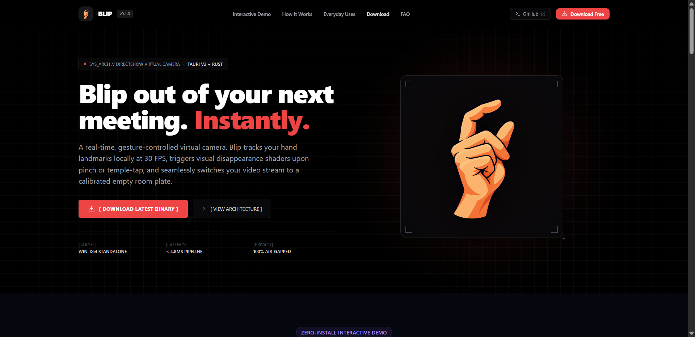
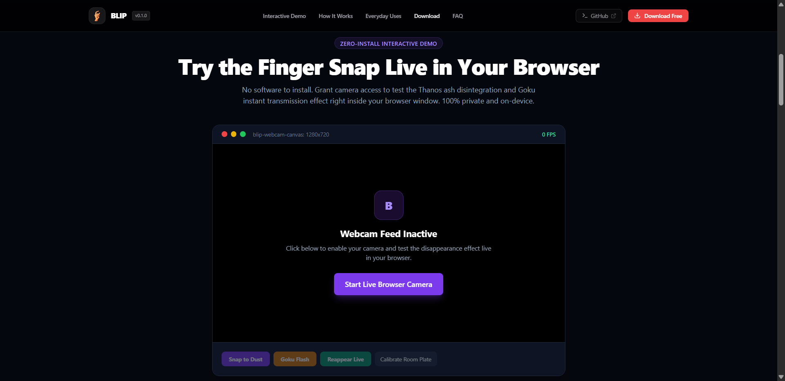

<div align="center">


# Blip

**Now you see me. Blip.**

A high-performance, gesture-triggered disappearance tool for Google Meet, Zoom, and Microsoft Teams.  
Snap your fingers like Thanos to dissolve into ash, or tap your temple like Goku to vanish instantly.

[](LICENSE)
[](https://jhaabhijeet864.github.io/blip)
[](https://jhaabhijeet864.github.io/blip/download/)
[](SECURITY.md)

<br/>

[](https://jhaabhijeet864.github.io/blip)

[Live Browser Demo](https://jhaabhijeet864.github.io/blip/#demo) • [Download Extension & Desktop](https://jhaabhijeet864.github.io/blip/download/) • [How It Works](#how-it-works) • [Quickstart](#quickstart)

</div>

---

## What is Blip?

Blip lets you vanish from live video meetings in real time. Snap your fingers or press a hotkey to trigger cinema-grade ash particle physics or an anime speedline flash, seamless clean-room plate replacement, and automatic microphone muting.

- **100% Free & Open-Source:** No paywalls, subscriptions, or paid unpack wrappers.
- **100% Private & Air-Gapped:** Zero cloud calls or telemetry. All computer vision and video processing runs on your local machine.
- **Two Ways to Run:** A zero-install **Chrome Extension** for browser calls, or a standalone **Windows Desktop App** for system-wide virtual camera support.

---

## Interactive Browser Demo

Test the snap physics right in your browser with zero installation:

<div align="center">

[](https://jhaabhijeet864.github.io/blip/#demo)

*[Launch the Live Simulator](https://jhaabhijeet864.github.io/blip/#demo) to test camera capture, Thanos ash disintegration, and empty room calibration.*

</div>

---

## Quickstart

### Option 1: Chrome Extension (Fastest for Google Meet & Web Calls)

Works on Google Chrome, Brave, Microsoft Edge, and Chromium browsers:

1. **Download the Extension:**
   - Grab the packaged zip from the [Downloads Hub](https://jhaabhijeet864.github.io/blip/download/) or download [`blip-extension.zip`](https://github.com/jhaabhijeet864/blip/releases/latest/download/blip-extension-v1.0.0.zip).
2. **Extract the ZIP:**
   - Right-click `blip-extension.zip` and choose **Extract All...** to any folder on your computer.
3. **Load in Chrome:**
   - Navigate to `chrome://extensions/` in your browser.
   - Toggle **Developer mode** ON (top-right corner).
   - Click **Load unpacked** (top-left) and select the extracted folder.
4. **Join Call & Vanish:**
   - Open [Google Meet](https://meet.google.com).
   - Click the **Blip** puzzle piece icon in Chrome or use the optional floating dock.
   - Click **Calibrate Room Plate (3s)**, step aside for 3 seconds while it snapshots your room, and you are ready. Snap your fingers or tap your temple to disappear.

---

### Option 2: Windows Desktop Standalone (System-Wide Virtual Camera)

Works across Zoom Desktop, Teams Desktop, Discord, and OBS Studio:

1. Download **`Blip-Windows-x64.zip`** from [Latest Releases](https://github.com/jhaabhijeet864/blip/releases/latest).
2. Extract the archive to any folder. No installer wizard or admin privileges required.
3. Double-click `Blip.exe`.
4. Select your webcam, click **Start Camera**, and snapshot your empty room plate.
5. In Zoom, Teams, or OBS, choose **Blip Virtual Camera** as your video source.

---

### For Developers (Build From Source)

```bash
# Clone the repository
git clone https://github.com/jhaabhijeet864/blip.git
cd blip

# Build and test the Chrome Extension
npm --prefix extension install
npm --prefix extension run build
npm --prefix extension test

# Build and run the Next.js Showcase Website
npm --prefix web install
npm --prefix web run dev
```

---

## How It Works

1. **Empty Room Calibration:** Step out of view for 3 seconds. Blip snapshots the clean room plate at native camera resolution and stores it locally.
2. **Live Gesture & Click Detection:** Tracks hand landmarks at 30+ FPS and listens for acoustic snap transients.
3. **Disappearance FX:** Procedurally generates 1,500+ ash particles with trigonometric curl turbulence or triggers an anime whiteout flash bloom.
4. **Clean Switch & Auto-Mute:** Replaces live video with your empty room plate and optionally mutes your microphone until you decide to reappear.

---

<div align="center">

Distributed under the [MIT License](LICENSE).  
Maintained by [Abhijeet Jha](https://github.com/jhaabhijeet864) and the open-source community.

</div>
